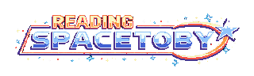
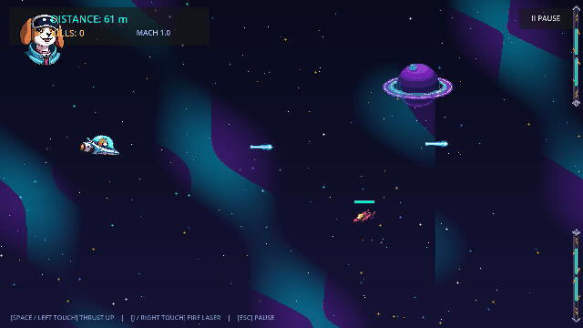
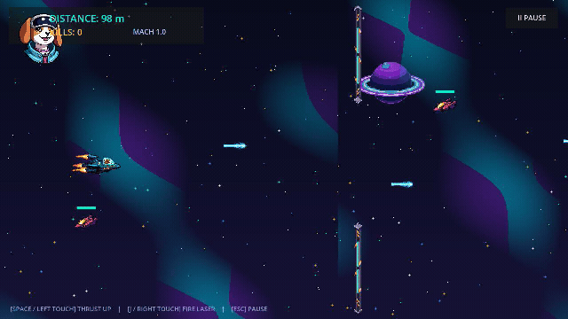

# SpaceToby

<p align="center">
  
</p>

<p align="center">
  A pixel-art space arcade game about Toby, a beagle mercenary escaping with the Quantum Crystal.
</p>

<p align="center">
  <a href="https://github.com/henriquerochars/spacetoby/actions/workflows/ci.yml"></a>
  
  
</p>

## Gameplay

<p align="center">
  
</p>

<p align="center">
  
</p>

## The game

Pilot Toby through a dangerous asteroid sector after he steals the Quantum Crystal from crime boss Baron Vex. Thrust through procedural obstacles, shoot down enemy ships, and push your best distance and kill count higher with every run.

### Highlights

- Flappy-inspired flight with gravity, thrust, pitch animation, and responsive keyboard, mouse, and multitouch controls.
- Three enemy classes—Scout, Fighter, and Heavy—with distinct durability, movement, and attacks.
- Procedural station gates and asteroids with reachable corridors, plus difficulty that scales with distance.
- Original pixel art, an opening heist cutscene, chiptune music, and animated thruster and explosion effects.
- Optional online profiles, server-issued game sessions, anti-cheat validation, and separate kills and distance leaderboards.
- Playable offline as a guest; account features require the local API and PostgreSQL.

## Quick start

### Requirements

- Godot **4.7.2**; install the matching Web export templates to create browser builds.
- Node.js **22+** and pnpm **10+**.
- Docker Engine with Docker Compose v2 for local PostgreSQL and the API.

### Run locally

```bash
git clone https://github.com/henriquerochars/spacetoby.git
cd spacetoby
pnpm install
pnpm db:generate
cp .env.example .env
export JWT_SECRET="$(openssl rand -hex 32)"
docker compose up -d
```

Compose starts PostgreSQL and the API, applies the Prisma migrations, and binds host ports to loopback. To run the API directly instead, start only the database and apply migrations first:

```bash
docker compose up -d postgres
pnpm db:migrate
pnpm dev
```

In another terminal, launch the game:

```bash
pnpm game:run
```

The API health check is at `http://localhost:3000/health`; Swagger is at `http://localhost:3000/api/docs`.

### Browser build

```bash
pnpm game:export:web
npx serve apps/game/build/web
```

The export script requires Godot 4.7.2 and creates native HTML, JavaScript, WebAssembly, and PCK artifacts in `apps/game/build/web/`.

## Controls

| Action | Desktop | Mobile |
| --- | --- | --- |
| Thrust | `Space`, `W`, `Up`, or left click | Tap/hold the left side |
| Fire | `J`, `Z`, `K`, or right click | Tap/hold the right side |
| Pause | `Esc` or `P` | Pause button |
| Advance cutscene | `Space` or click | Tap the screen |

## Local accounts and API

Email/password accounts and player profiles are stored in PostgreSQL. Passwords use salted scrypt hashes; the API issues signed JWTs using `JWT_SECRET`. Set a unique secret of at least 32 characters in `.env` before running the API. The Compose API and database ports are exposed only on `127.0.0.1` for local development.

Password recovery is **not configured** yet: `POST /api/v1/auth/recover` returns HTTP 501 and does not send email. See the [REST API guide](docs/api/REST_API.md) for routes and behavior.

## Validation

```bash
pnpm lint
pnpm build
pnpm test
pnpm test:e2e
./scripts/test-game.sh
pnpm game:export:web
```

The headless Godot suite checks gameplay systems, required assets, and all seven screens. CI runs the backend checks, imports the Godot project, runs the gameplay suite, and verifies the native WebAssembly export.

## Project layout

```text
apps/game/       Godot client, scenes, scripts, art, audio, and tests
apps/api/        NestJS API, Prisma schema, migrations, and tests
packages/        Shared TypeScript API contracts
docs/api/        REST API reference
docs/gameplay/   Controls and gameplay tuning
docs/architecture/ System overview
docs/assets/     Pixel-art manifest and gameplay GIFs
scripts/         Asset generation, game tests, and native web export
```

More detail: [Gameplay & Tuning](docs/gameplay/GAMEPLAY.md) · [REST API](docs/api/REST_API.md) · [Architecture](docs/architecture/OVERVIEW.md) · [Asset Manifest](docs/assets/ASSET_MANIFEST.md).
